# 领导演示逐字稿（约 20 分钟）

> 状态：可直接照读
> 场景：向领导演示「货拉拉订单本体系统」的价值
> 页面：`http://10.129.33.121:8765/profile/order-ontology`（STG `stg-121`，端口 8765）
> 数据：以下数字均为 2026-11-21 在 STG 实测返回，非估算
> 依据：[demo_script.md](demo_script.md)、[demo-interactive-plan.md](demo-interactive-plan.md)、[palantir-benchmark.md](../roadmap/palantir-benchmark.md)
> 口径：不宣称「离开本体绝对不可能」；统一说「只给原始数据、不给声明，答不出来；改一行声明，行为立刻翻转，代码零改动」

---

## 0. 上台前 5 分钟（不是口播，照着做）

1. 确认 STG 服务活着：浏览器能打开 `http://10.129.33.121:8765/profile/order-ontology`，接口 `/freight/health` 返回 200。
2. 上台前跑一遍自检：`python scripts/demo_gate.py --fast --strict`，必须显示「演示就绪」。
3. 若时间充裕，再跑一遍**完整版** `python scripts/demo_gate.py`（含真实大模型推理链），确认 Qwen（STG 网关 `qwen3.6-plus`）出网正常；跑不通就现场只讲确定性的 M5 两步，不点真实推理链。
4. 浏览器全屏、放到 110% 缩放，提前打开页面，停在第一个场景。
5. 红线：**不本地起服务、不部署 PRD**；任何异常如实说，不切本地替身。

---

## 1. 开场（约 1 分钟）

【站定，指向屏幕】

> 各位领导，今天用 20 分钟讲清楚三件事：
>
> 第一，**本体到底是什么**，为什么它不是一张表、也不是一个图数据库；
>
> 第二，**我们为什么选 Palantir 路线，而不是 W3C 的 OWL 路线**；
>
> 第三，也是最重要的——我会**现场点、现场看**，用六个问题证明这套本体是真的在干活：同一份数据，改一行本体声明，结论立刻翻转，**代码一行不改**。
>
> 所有结果都来自 STG 实时接口；文内截图是同一环境的实录，现场仍会重新点一遍。

---

## 2. 本体是什么（约 3 分钟）

【切到页面顶部，或用手比划】

> 先讲概念，一句话：
>
> **本体，就是把一门业务里「有哪些东西、它们怎么连、守什么规矩、能做哪些动作、谁能看、凭什么证明」，集中定义一次，让全公司所有系统共用同一份定义。**
>
> 拿我们这单货举例，本体里定义了六样东西：
>
> 一是**类**——运单、费用项、司机、结算单。它们不是数据库表，是业务概念。
>
> 二是**属性**——金额、等候分钟数、回单编号，以及每个属性的类型。类型很关键，等会儿您会看到，改错一个类型，系统当场拒绝写入。
>
> 三是**关系**——这张运单挂了哪几条费用、由哪个司机承运、对应哪张报价单。
>
> 四是**规则**——比如等候费：免费 30 分钟，超出部分每 5 分钟 2.4 元。规则是写成公式的，机器能直接算，不是一段说明文字。
>
> 五是**动作和状态机**——运单从「已创建」到「已接单」「已装货」「已送达」，每一步谁能做、什么状态能做，都写在本体里。
>
> 六是**权限和证据**——哪条数据带什么密级、哪个角色能看到、这笔费用由哪个系统出具证据。
>
> 所以本体不是「画一张关系图给人看」，而是**让机器理解并执行业务规则的一份可执行契约**。这是今天所有演示的地基。

【如果领导只给 30 秒，就说这一句】
> 一句话：本体是业务概念、关系、规矩、动作、权限、证据的**唯一真相源**，而且这份定义是**可执行**的。

---

## 3. 路线选择：Palantir 路线 vs W3C / OWL 路线（约 2 分钟）

【语气放稳，这段是定调】

> 做本体有两条主流路线，我们做了明确取舍。
>
> **第一条是 W3C 路线**，核心是 RDF、OWL、SHACL 这一套。它的优点是形式严谨：概念可以形式化推理，能证明「A 一定属于 B」，也方便跨组织交换。它像什么？像给业务写一部**法律词典**——非常严谨，但离「今天下午就要拦住一个越权改派、算清一笔费用」还有一段距离。OWL 推理重、落地慢，SHACL 主要做校验，不负责执行动作、不管权限传播、也不算钱。
>
> **第二条是 Palantir 路线**，核心是把本体做成**可操作的业务对象**：对象类型、属性、关系、动作、权限、函数、血缘，全部长在本体上，本体直接驱动读写、动作、权限和 AI 工具。它像什么？像把法律词典**变成一套能签发、能拦人、能算账的业务系统**。
>
> 我们选的是 **Palantir 路线做主干**，因为它解决的是我们当下最痛的四件事：口径乱、证据散、AI 乱编、权限失控——这些要的是**可执行、可治理**，不是论文级的完备性。
>
> 同时我们没有放弃 W3C：SHACL 校验已经接进 CI 门禁，将来确有跨组织交换或形式推理的硬需求，可以平滑外挂 OWL 推理，不需要推倒重来。
>
> 一句话总结我们的取舍：**我们不追求把本体写成一篇论文，我们追求让本体当天就能拦住一个越权动作、算清一笔费用。**

【术语读音卡：下面第一次提到时顺口带过，领导追问时直接用】

| 缩写 | 英文全称 | 英文读音 | 中文全称 |
|---|---|---|---|
| **Ontology** | Ontology | /ɒnˈtɒlədʒi/，读“昂-托-勒-吉” | **本体** |
| **OWL** | Web Ontology Language | /aʊl/，读“猫头鹰”owl | **Web 本体语言** |
| **RDF** | Resource Description Framework | /ˌɑːr diː ˈef/，逐字母 R-D-F | **资源描述框架** |
| **SHACL** | Shapes Constraint Language | /ˈʃækəl/，读 shackle“枷锁” | **形状约束语言** |
| **SWRL** | Semantic Web Rule Language | /swɜːrl/，读 swirl“旋转” | **语义 Web 规则语言** |
| **Axiom** | Axiom | /ˈæksiəm/，读“艾克西姆” | **公理** |
| **Reasoner** | 不是缩写，源自 reason | /ˈriːzənər/，读“瑞森纳” | **本体推理机 / 推理器** |
| **W3C** | World Wide Web Consortium | /ˌdʌbəljuː θriː ˈsiː/，读“double-u three C” | **万维网联盟** |

> 现场说法：“OWL，Web 本体语言，读 owl，猫头鹰；RDF，资源描述框架，读 R-D-F；SHACL，形状约束语言，读 shackle，枷锁；SWRL，语义 Web 规则语言，读 swirl，旋转；Axiom，公理，读‘艾克西姆’，它是 OWL 推理的基本单位；Reasoner，本体推理机；W3C，万维网联盟。”
>
> 如果领导只关心业务，不用主动展开 RDF、SWRL、Axiom 和 Reasoner；被问到“你们做不做形式推理”时再补这一句。

---

## 4. 交互演示：六条主线（约 11 分钟）

> 讲解节奏统一为四拍：**先问 → 点一下 → 看屏幕 → 抽掉声明看翻转**。
> 每一步页面都会显示 INPUT 和 OUTPUT，请求是现场点出来的，不是预跑数据。文内截图均来自同一 STG 页面，仅用于会后回看；现场以实时返回为准。

### M1 · 承重：同一笔费用，换一版本本体，结论会变吗？（约 2 分钟）

【点击第一个场景「同一笔费用，换一版本本体，结论会变吗？」】

> 先看运单 WB20261105001，当前加载的本体版本是 **3.0.0**。屏幕给出三个关键数：免费等候 **30 分钟**，规则应计 **12 元**，运单层面差异 **38 元**。
>
> 注意，12 元是本体按「等候费公式 + 版本 + 生效期」算出来的，不是从报价单里抄的。等候 53 分钟、实收 25 元这两个数，等会儿 M6 再展开。

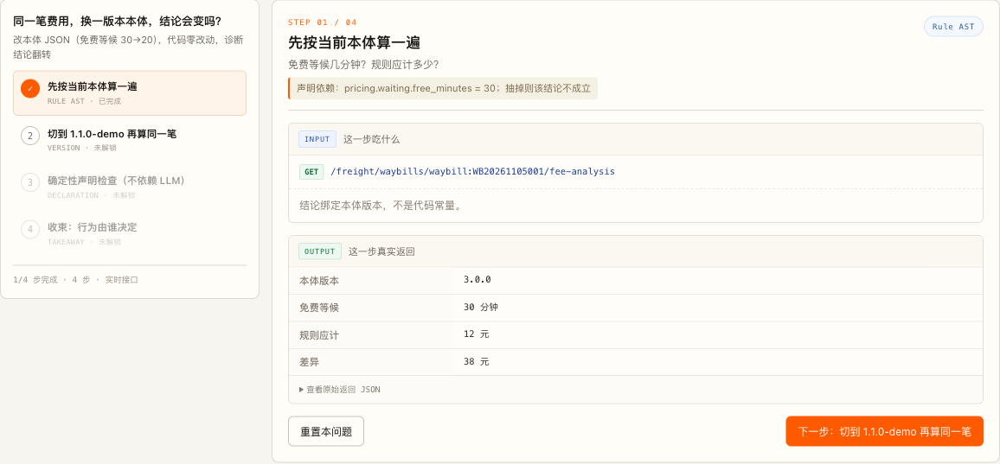

【点击「切到 1.1.0-demo 再算同一笔」】

> 现在只做一件事：把版本切到 `1.1.0-demo`，**代码一行没改，数据一条没动**。
>
> 屏幕立刻变化：免费时长从 30 分钟变成 **20 分钟**；但更关键的是，这个版本的本体里没有可执行的计价公式，系统直接给出 **ONTOLOGY_COMPUTE_MISSING**，把结论标成 BLOCKER，不参与差异判定。

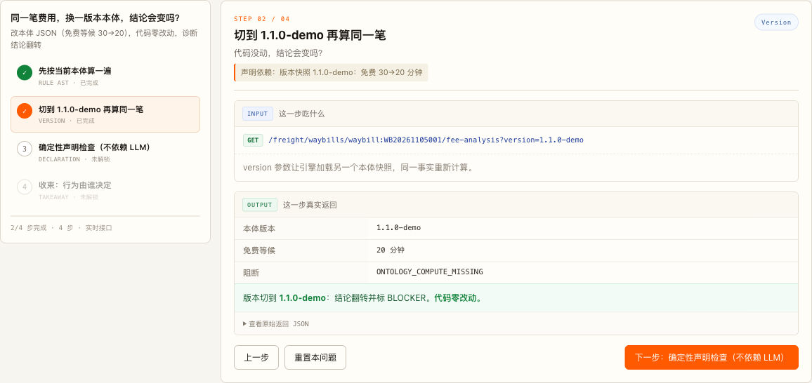

> 这就是本体和普通代码最大的区别：**结论被本体声明决定**。改声明，行为立刻翻转；算不出来就明确报阻塞，绝不给你一个假数字。

【点击「确定性声明检查（不依赖 LLM）」】

> 这一小步完全不调大模型。只抽掉 `ontology.catalog` 这一条工具声明，工具数就从 **15 变成 14**，页面立刻翻转出 **TOOL_UNAVAILABLE**。证据 checksum 是 `80e66b84a7ff`，同样由本体声明决定。

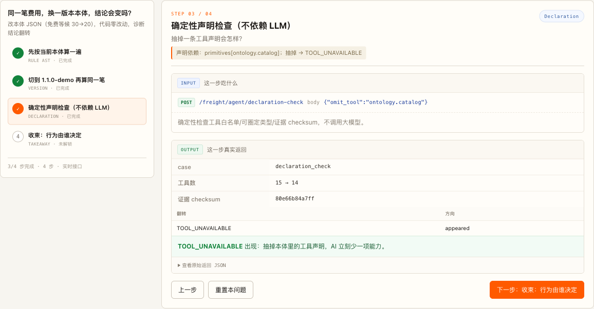

【点击「收束：行为由谁决定」】

> 页面把两个版本并排放：当前 **3.0.0**，演示 **1.1.0-demo**。同一份事实、两份声明、两个结论。

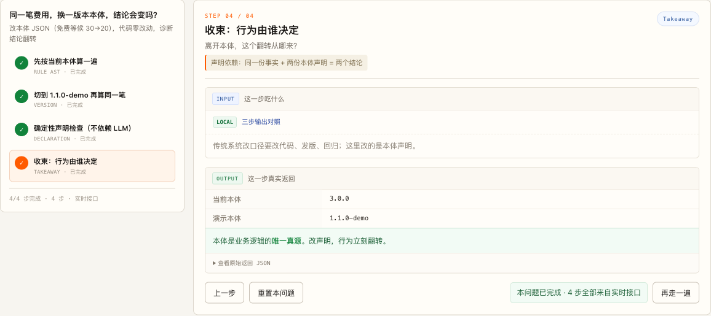

**收束台词**
> 传统系统改口径要改代码、发版、回归；这里改的是本体声明，行为翻转，代码零改动，而且可版本化、可追溯。

---

### M2 · 状态机：已送达的运单还能改派吗？（约 2 分钟）

【点击第二个场景「已送达的运单还能改派吗？」】

> 看 Waybill 的状态机声明：终态是 **DELIVERED**，一共 **5 个状态**、**4 条迁移边**（接单、改派、装货确认、送达）。这张运单当前就是 DELIVERED。
>
> 问题来了：已送达的运单，还能不能改派？

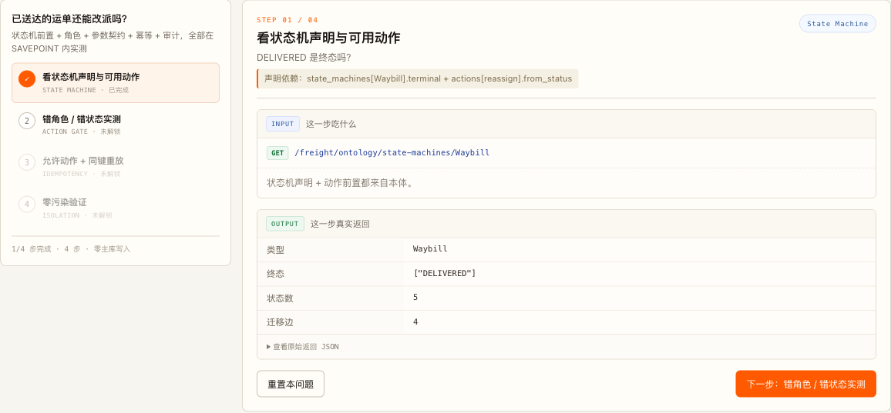

【点击「错角色 / 错状态实测」】

> 第一个测试：陌生人去接单，拒绝，拒绝码 **FORBIDDEN_ROLE**。
>
> 第二个测试：对已送达的运单发起改派，拒绝，拒绝码 **RULE_REJECTED**。
>
> 两个拒绝都不是前端灰按钮，是本体里的角色声明和状态机前置在拦。

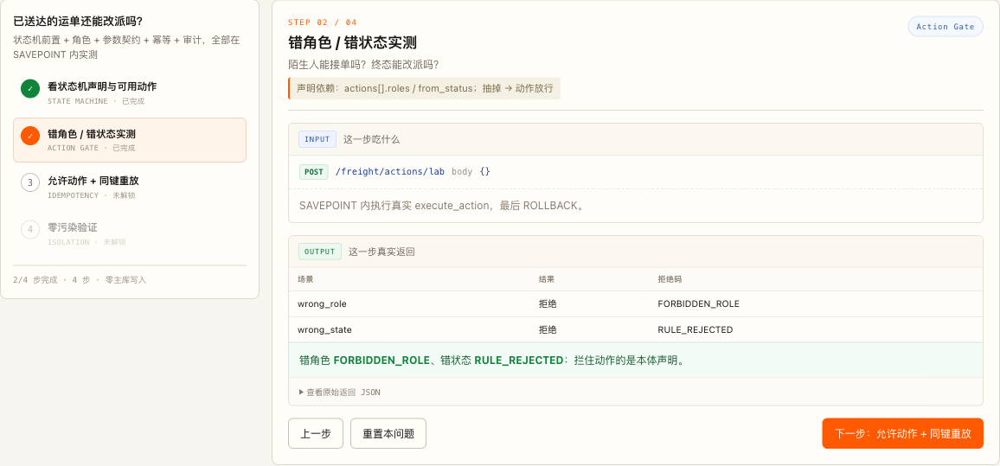

【点击「允许动作 + 同键重放」】

> 再做一个合法动作：放行。然后用**同一个幂等键再按两次**：页面显示重放分别是「否、是、是」——**只真正执行了一次**。网络抖动、用户连点、消息重投，都不会重复扣费、重复改状态。

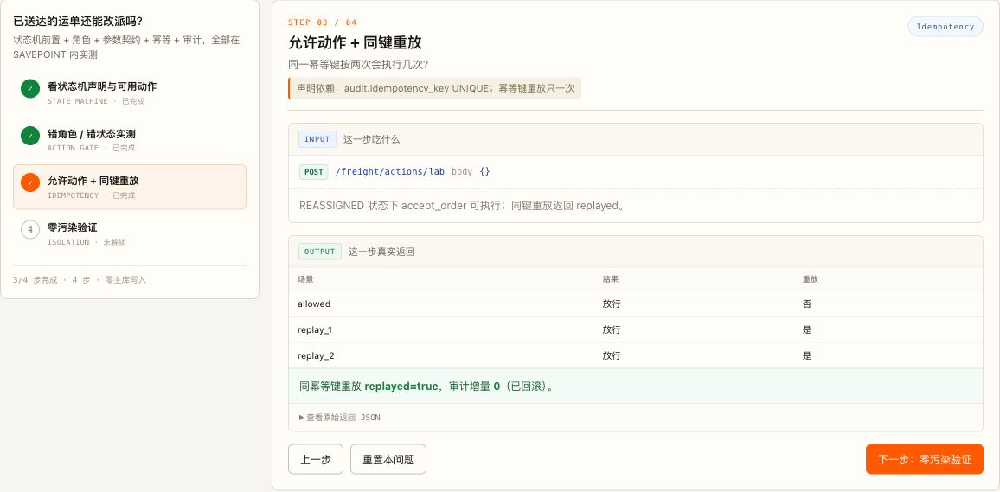

【点击「零污染验证」】

> 刚才这些拒绝、放行、重放，全部在数据库事务里做，做完立刻回滚。屏幕显示：**审计增量 0，状态还原「是」，persisted 为 false**。
>
> 演示再怎么折腾，主库一条记录都不会脏。这是我们敢现场随便点的底气。

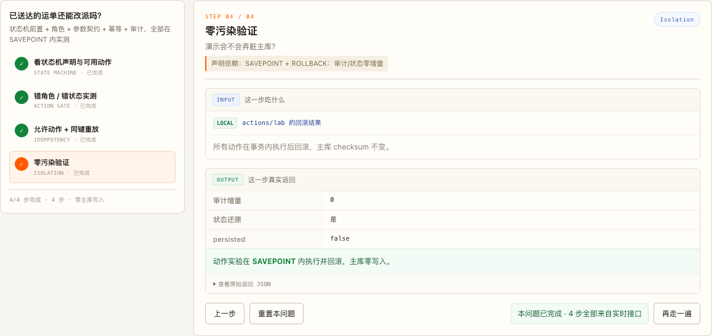

**收束台词**
> 拦住动作的是本体里的角色声明和状态机，而且可以在事务里被实测、被验证零污染。

---

### M3 · 来源契约：这笔费用谁认领、缺什么证据？（约 2 分钟）

【点击第三个场景「这笔费用谁认领、缺什么证据？」】

> 这单共 **7 条费用行**。问题不是「有没有数据」，而是「每条费用由哪个源系统认领、证据够不够」。
>
> 正常情况：7 条全部已解析，缺口 **0**，findings **0**。这个 0 不是「恰好没差」，是本体声明了「谁负责」，逐条对完才敢说 0。

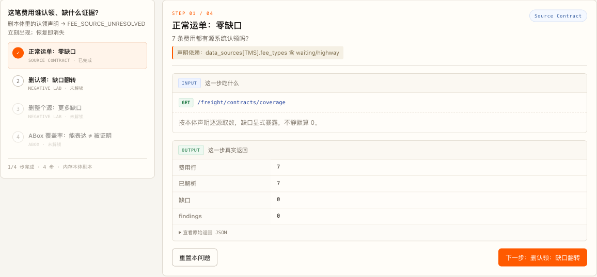

【点击「删认领：缺口翻转」】

> 现在删掉一条声明：TMS 不再认领等候费。屏幕立刻出现两条缺口：**FEE_SOURCE_TYPE_UNDECLARED** 和 **FEE_SOURCE_UNRESOLVED**，findings 从 0 变成 **2**。
>
> 不是代码里写死一个检查，是从「数据源—费用类型」认领关系推出来的。删声明，缺口立刻暴露。

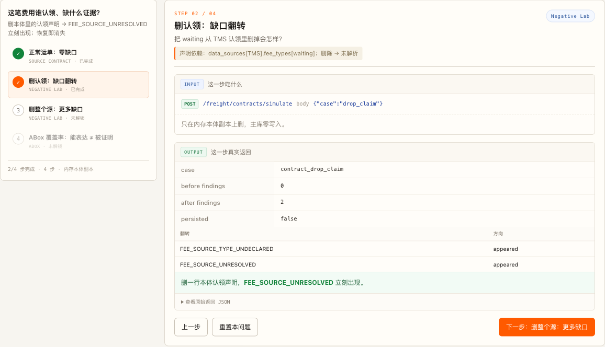

【点击「删整个源：更多缺口」】

> 再狠一点，把整个 TMS 连接器删掉：变更前缺口 **0**，变更后 **6**，persisted 仍是 false。

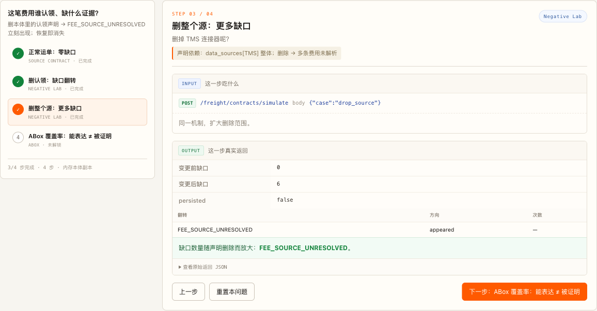

【点击「ABox 覆盖率：能表达 ≠ 被证明」】

> 这里说一句诚实话：本体定义了 **500 个类**，真正有实例数据的是 **18 个核心类**。页面如实显示：核心类覆盖 **18/18**，边覆盖 **18/18**，另有 **2 个覆盖问题**如实列出，不做「定义了多少就等于落地了多少」的美化。
>
> **能表达，不等于被证明。**

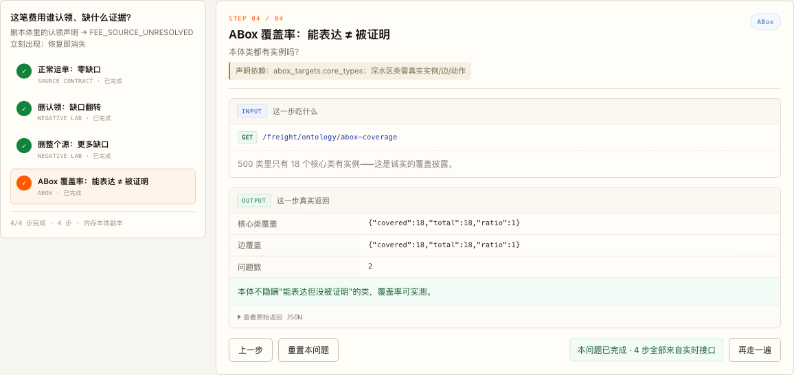

**收束台词**
> 缺口不是事后扫描出来的，是本体声明在当场定义的「谁负责」。删掉声明，缺口立刻出现；补回来，立刻消失。

---

### M4 · 权限：同一结论，为什么不同角色看到的不一样？（约 2 分钟）

【点击第四个场景「同一结论，为什么不同角色看到的不一样？」】

> 同一批费用行，共 **9 行**。不同人看到的不该一样。

【点击「匿名 vs 争议角色」】

> 匿名用户可见 **7 行**，另外 **2 行**因为挂了争议工单的密级标记，对他不可见。

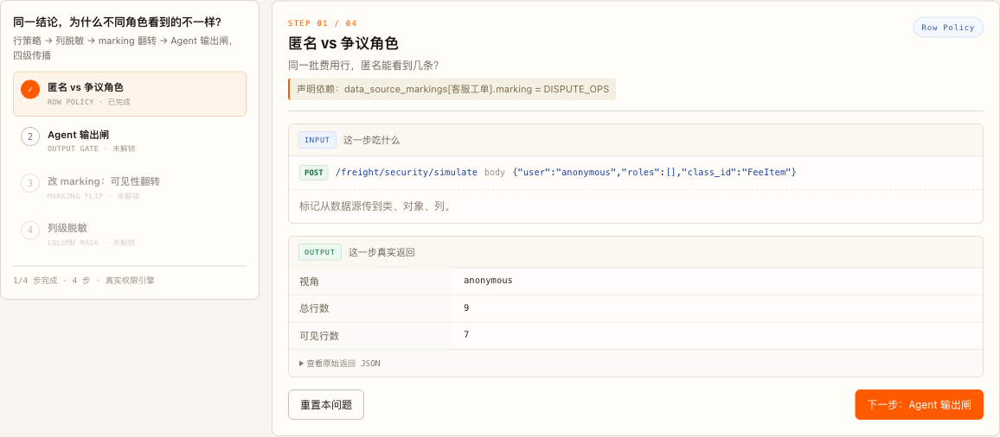

【点击「Agent 输出闸」】

> 更关键的是：如果 AI Agent 想把带密级的工单内容说出去，行不行？
>
> 页面返回 **DENIED**，原因是 **OUTPUT_MARKING_DENIED**。权限不只在查询时拦，**一路管到 AI 的输出口**。

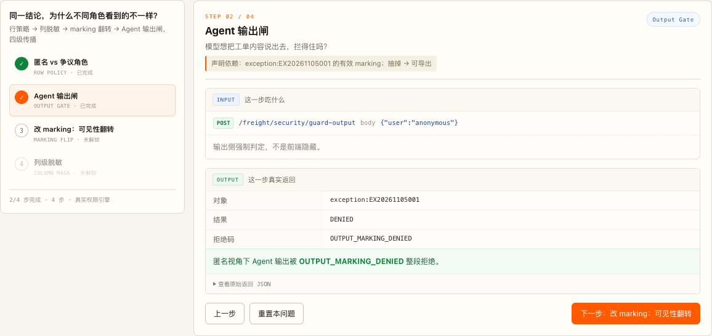

【点击「改 marking：可见性翻转」】

> 我删掉一个数据源上的密级标记。ExceptionTicket 的可见行从 **0 变成 2**——同一批数据，权限声明一变，谁能看见立刻变，persisted 为 false。

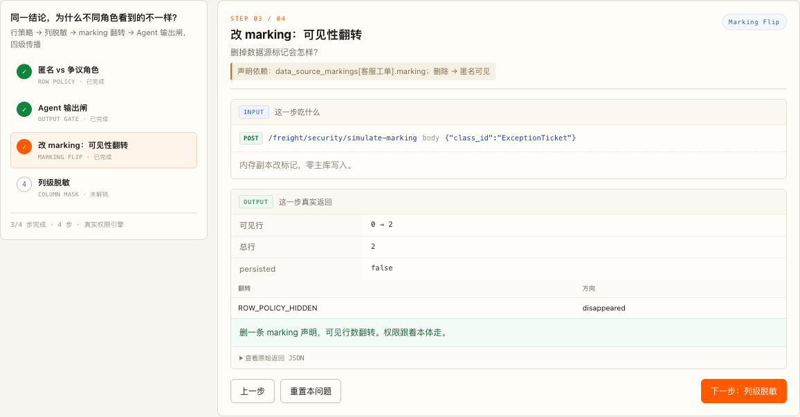

【点击「列级脱敏」】

> 还要注意：行可见，不代表字段可见。匿名视角下共 **7 个对象**，首个对象可见属性 **0**——列级策略把敏感字段挡在外面。

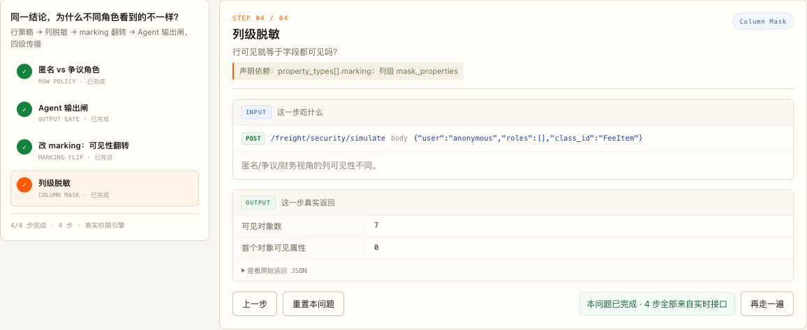

**收束台词**
> 权限是跟着本体属性走的，从数据源、到对象、到字段、再到 Agent 输出，一路传播。它不是页面上的一个开关，是数据流的**内建属性**。

---

### M5 · AI：凭什么不编？（约 1.5 分钟）

【点击第五个场景「AI 凭什么不编？」】

> 现在都讲 AI，但领导最担心的是：它会不会张口就来？
>
> 我们的答案是：**模型负责理解人话，本体决定它能看什么、能算什么。**

【点击「确定性声明检查」】

> 第一步完全不依赖大模型。页面显示：工具白名单 **15 个工具**、可圈定类型 **500 个类型**、证据 checksum `80e66b84a7ff`，三项都由本体声明决定。

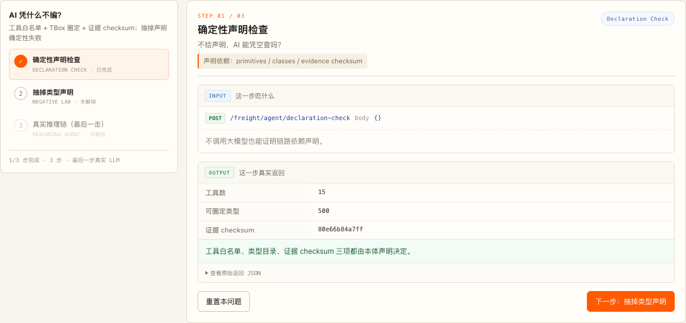

【点击「抽掉类型声明」】

> 我把 `FeeItem` 这个类型声明删掉，注意——只在内存副本里删，不改主本体。结果：**TYPE_UNBOUND**，模型**不可圈定**这个类型，链路上不去。
>
> 这不是模型「不愿意」编，是**本体没给它编的入口**。抽掉工具声明，就是 **TOOL_UNAVAILABLE**；抽掉类型，就是 **TYPE_UNBOUND**。确定性失败，没有降级替身。

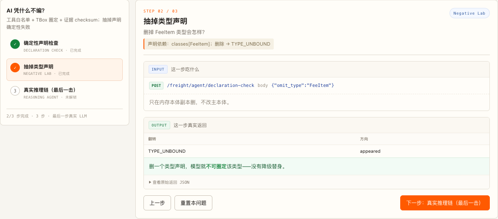

【可选，时间够再点「真实推理链（最后一击）」】

> 这一步才是真的调大模型。您看，点开只是创建一个会话，页面明确写着「**此时还没调大模型**」，模型名是 **qwen3.6-plus**，下一步待执行 catalog，**每一步都要人点一下才执行**。
>
> （若继续点）模型在 TBox 圈定的范围内选工具、取证据，最后给出带证据链的诊断。它不能跳出本体范围自由发挥。

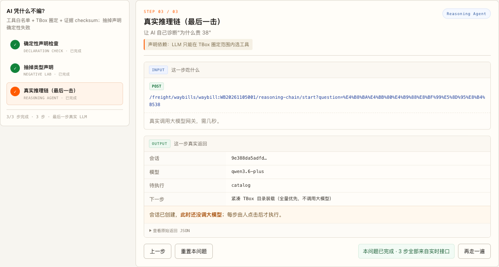

**收束台词**
> 幻觉不是靠「提示词求它别编」来解决的，是靠**本体把边界划死**来解决的。

---

### M6 · 收束：这单到底为什么贵 38？（约 1.5 分钟）

【点击第六个场景「这单到底为什么贵 38？」】

> 最后把前面所有能力汇成一个结论。

【点击「规则应计 vs 实收」】

> **53 分钟**等候，规则应计 **12 元**，实收 **25.00 元**，本体版本 **3.0.0**。免费 30 分钟、5 个计费块写在规则里。

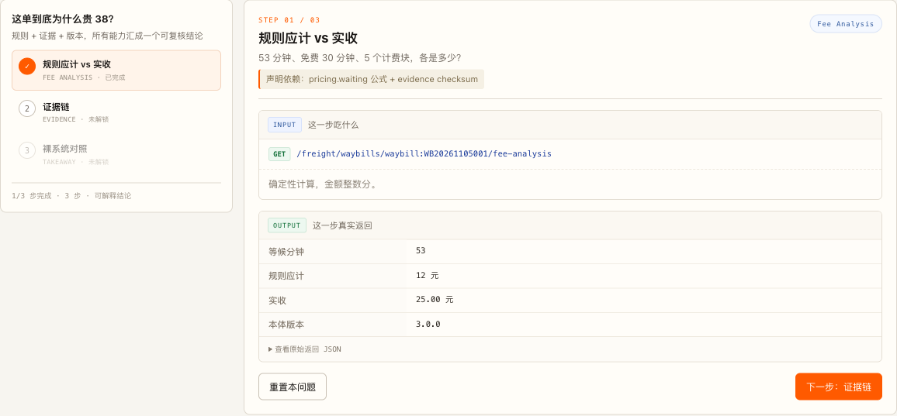

【点击「证据链」】

> 运单的证据链返回 **8 个时间线事件、14 条关系**，当前状态 DELIVERED。每笔费用由哪个系统、哪条证据证明，可以逐条回源，不靠模型记忆。

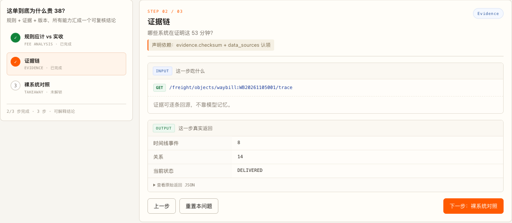

【点击「裸系统对照」】

> 最有说服力的一步：同一份原始数据，**不给本体**，直接丢给大模型，它会怎么答？
>
> 它会说「应收 0 元，多收 25 元，目前凭不上」——因为它把报价单里的 `0` 当成了应计值，也看不到计价规则。
>
> 而我们给结论：应计 **12.00**、实收 **25.00**、**超收 13 元**，附规则 ID、版本、生效期、证据 ID 和 checksum。
>
> **差的 13 元不在数据里，在计价规则里。** 本体把规则变成了机器可执行、可审计的东西——这就是它比「让大模型读表」多出来的那一步。

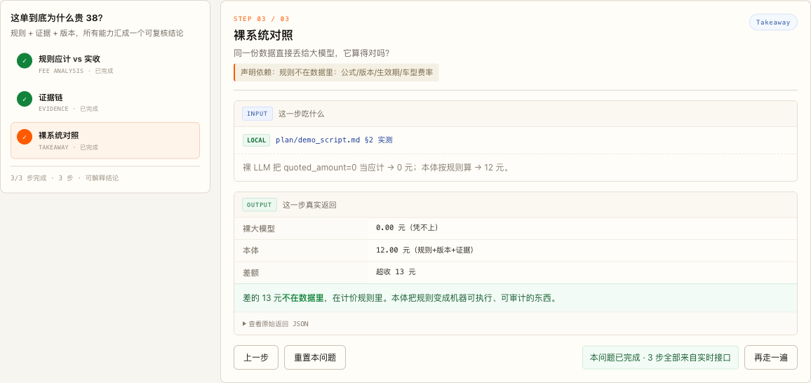

**收束台词**
> 同一份数据，裸大模型答错；本体答对，而且能给出证据、版本和时间。这就是我们说的「离开声明，答不出来」。

---

## 5. 深挖四题（约 3 分钟，领导追问时才展开）

> 页面里这四题默认折叠，是「追问菜单」，不主动讲。每题都保留实时接口和逐步截图。

### D1 · 改一个属性会波及谁？

> 血缘图实时返回 **4126 个节点、4163 条边**：类 500、属性 3527、规则 16、动作 15、证据 24、对象 18 全在同一张图。
>
> 查 `FeeItem.actual_amount`：上游 **32** 条、下游 **0** 条；再看运单对象影响面，**13 个对象**受影响。
>
> 改一个属性之前，先知道会波及谁，不是改完再救火。

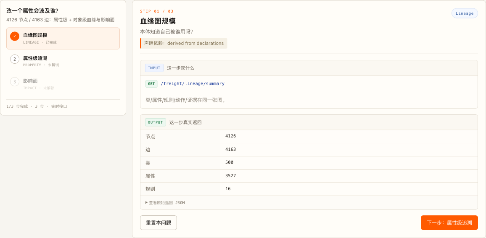
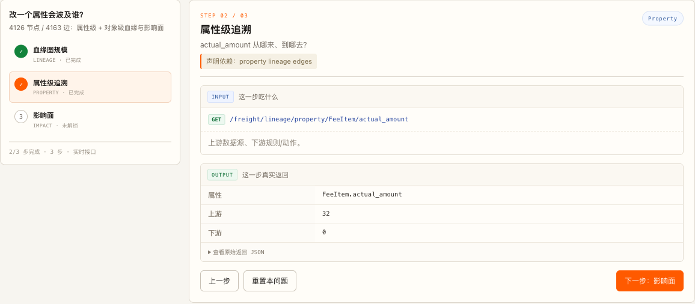
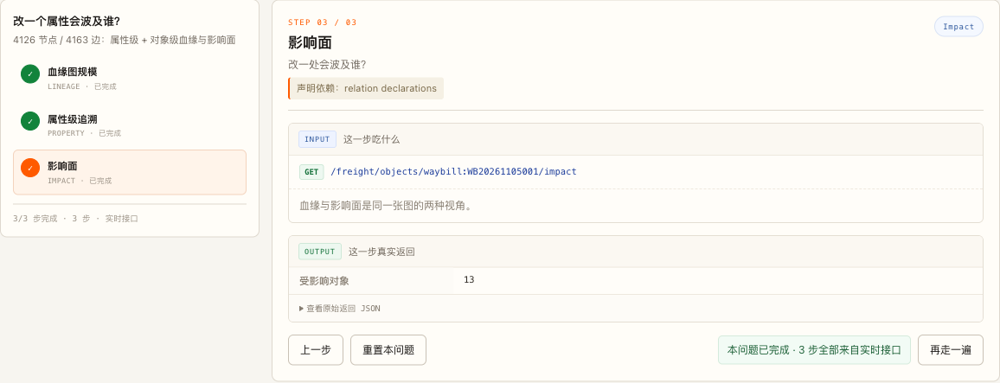

### D2 · 改本体能不能像代码一样评审？

> 能。删 `waiting_minutes` 属于破坏性变更，未签字直接 **FAIL**，影响面 1 条；补签后 **PASS**，未签字 0。签字路径与 classify 完全一致才放行，签名只存在于临时目录，不污染仓库。
>
> 版本页还能看到不可变快照：**1.1.0-demo**、**1.3.1-demo**，业务语义的 Git。

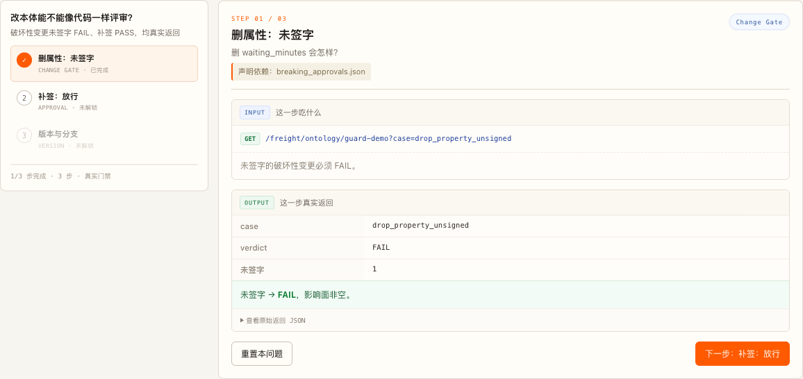
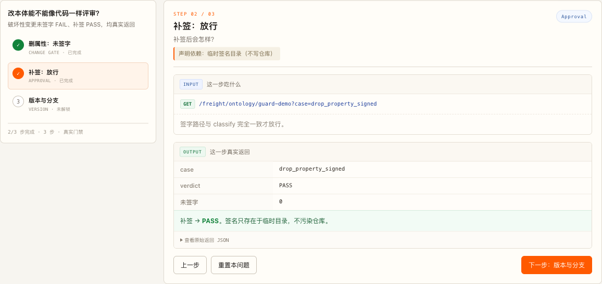
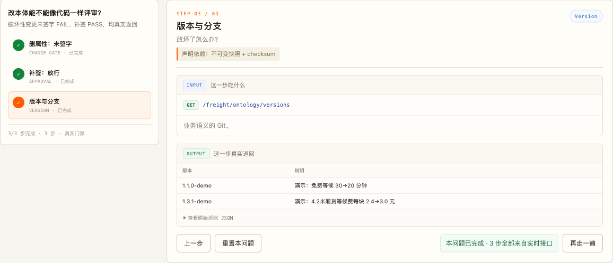

### D3 · 查业务语义，不查表名？

> 用业务语言查「争议费用」：Object Set 直接按 `FeeItem + status` 组集合，当前命中 **0**，查询计划 `projection_seek`。
>
> 换成 SQL 写法 `SELECT * FROM FeeItem`，命中 **7** 条，投影新鲜，取数路径 `full_scan`。
>
> 更关键的是接口多态：接口声明 **3 个**；删掉 `Chargeable` 的实现声明后，实现类 **2→1**，函数接受 **true→false**，翻转 **INTERFACE_VIOLATION**。

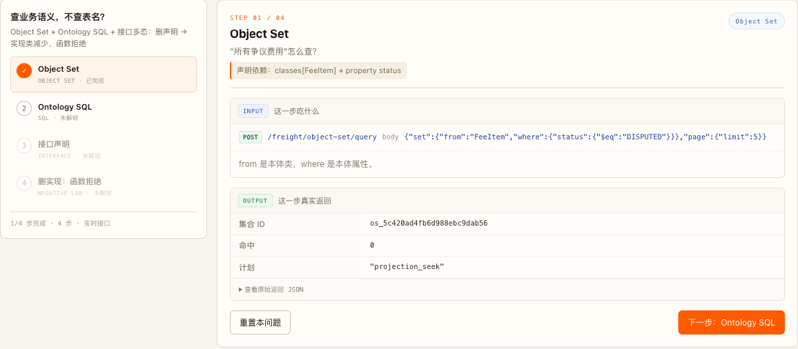
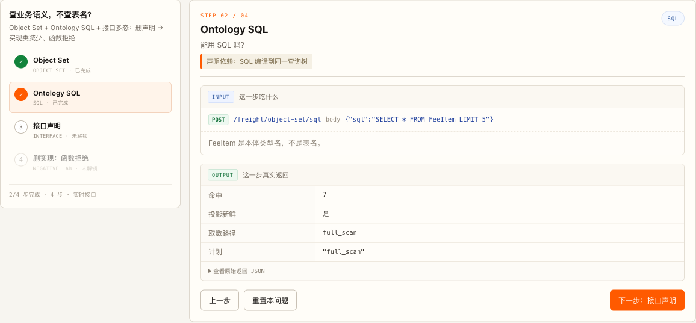
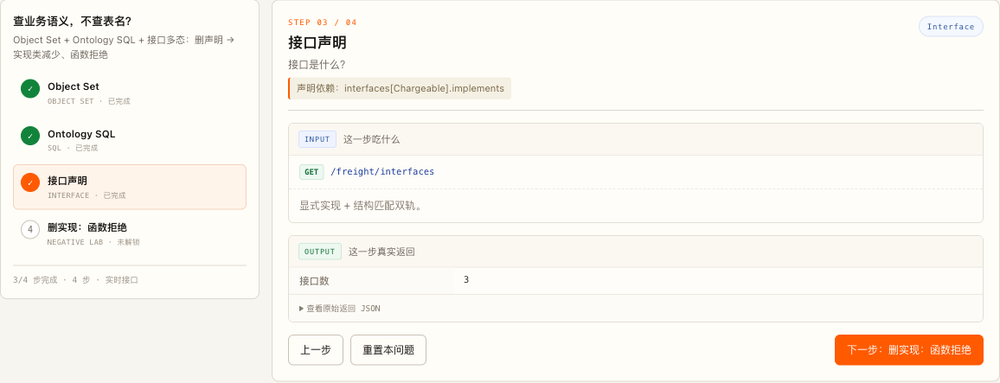
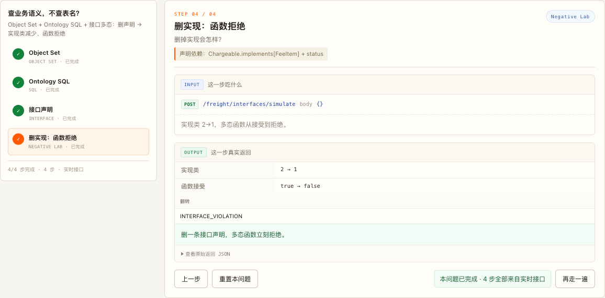

### D4 · 那么多属性注册表，真的执行吗？

> 真执行。Waybill 当前注册 **21 个属性**，策略 `strict`。把 `waiting_minutes` 的类型从 number 改成 boolean，创建路径当场拒绝，拒绝码 **TYPE_MISMATCH**，persisted 为 false。
>
> 注册表是契约，不是注释。

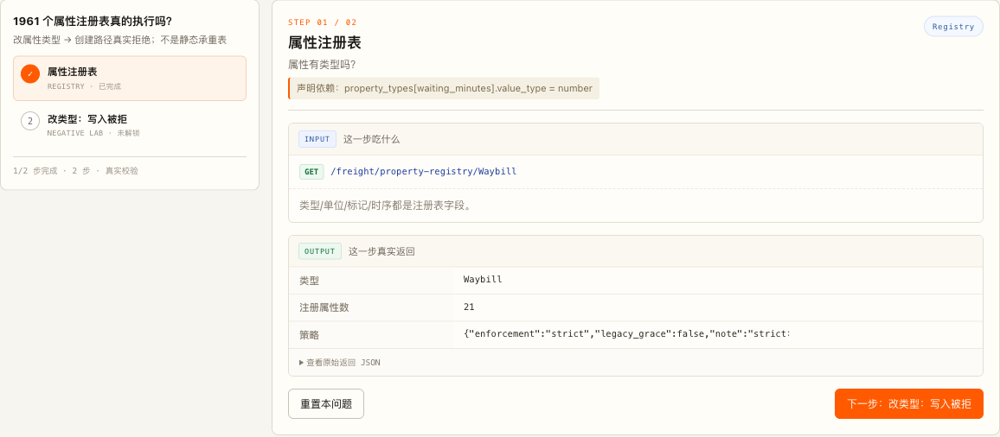
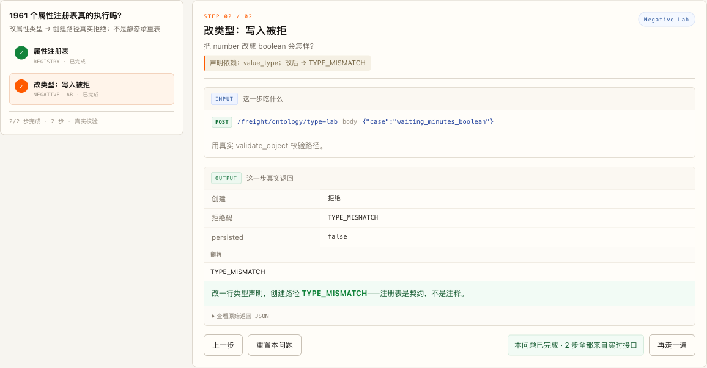

---

## 6. 交互式问题覆盖度与排他性自证（约 2 分钟，视领导兴趣）

> 结论先说：六个主线问题不是六个孤立 Demo，而是把本体的六类核心声明逐一压测；四个深挖题补齐治理、血缘、多态、注册表。每一问都给出「抽掉哪条声明、行为如何翻转」。

### 6.1 覆盖矩阵：每一问压的是哪块本体

| 问题 | 压测的本体核心 | 抽掉/改动的声明 | 屏幕上的翻转 |
|---|---|---|---|
| M1 换版本结论会变吗 | 规则、版本、生效期、可执行公式 | 本体版本 3.0.0→1.1.0-demo | 应计 12 → ONTOLOGY_COMPUTE_MISSING（BLOCKER） |
| M2 已送达还能改派吗 | 状态机、角色、幂等、事务 | 角色 / 当前状态 | FORBIDDEN_ROLE、RULE_REJECTED、replayed=true |
| M3 谁认领、缺什么证据 | 数据源认领、类型声明、证据 | 删单条认领 / 删整个源 | findings 0→2→6 |
| M4 不同角色看到什么 | 行策略、列脱敏、输出闸 | 删 marking | 可见行 0→2；Agent 输出 DENIED |
| M5 AI 凭什么不编 | 工具白名单、类型圈定、证据 | 抽工具 / 抽类型 | TOOL_UNAVAILABLE、TYPE_UNBOUND |
| M6 到底为什么贵 38 | 规则+证据+版本合成结论 | 不给本体声明，直接丢大模型 | 裸模型 0.00 vs 本体 12.00 |
| D1 改属性波及谁 | 属性级/对象级血缘 | 查 actual_amount / 影响面 | 上游 32、影响 13 个对象 |
| D2 改本体能评审吗 | 版本快照、签字、回滚 | 未签字 vs 补签 | FAIL / PASS |
| D3 不查表名查语义 | Object Set、SQL 编译、接口多态 | 删实现声明 | 实现类 2→1，函数拒绝 |
| D4 注册表真执行吗 | 属性类型、创建校验 | number→boolean | TYPE_MISMATCH |

这样，**类、属性、关系、规则、动作、状态机、权限、证据**八类核心要素全部被点到；版本、签字、回滚、血缘、多态、注册表六个治理面由深挖补齐。

### 6.2 哪些问题「离开本体答不出来」

我们不说「离开本体绝对不可能」，可复核的口径是：

| 只给什么 | 会得到什么 | 为什么不够 |
|---|---|---|
| 原始费用表 + 裸 SQL | 看得到 `quoted_amount=0`、`actual_amount=25`，**算不出应计 12 元** | 规则、版本、生效期、车型费率不在数据里 |
| 原始运单表 + 裸 SQL | 看得到 `status=DELIVERED`，**不会自动拒绝改派** | 角色、前置状态、幂等键不是数据库约束 |
| 原始费用表 + 裸 SQL | 看得到费用行，**判不出「谁认领、缺什么证据」** | 「数据源—费用类型」认领关系不在表里 |
| 原始数据 + 裸大模型 | 实测把 `0` 当应计值，答 **0.00 元**，错误 | 模型没有规则、版本、证据边界 |
| 本体 + 全链路 | 应计 **12.00**、实收 **25.00**、超收 **13**，附规则 ID/版本/证据 | 声明可执行、可审计、可版本化 |

所以准确说法是：**离开本体，不是算不出来，而是必须再重建一套等价的声明系统；而重建出来的那套东西，就是本体。** 本体不是某段代码的附属，而是结论的前置条件。

### 6.3 STG 覆盖度自检

在 STG 跑 `python scripts/demo_coverage_audit.py --fast`，结果：

- 6 主线 + 4 深挖覆盖矩阵完整；
- **11 个负向翻转全部命中**：换版本、抽工具、删认领、删源、改 marking、输出闸、抽类型、删实现、改类型、未签字/补签；
- 裸 SQL 与裸大模型对照实验都无法得到可审计的 12 元结论，只有本体全链路返回 12 元。

一句话收束：**六个问题把本体的核心声明全串起来；四个深挖证明它可治理；对照实验证明它不是「换一种写法」，而是结论能否成立的前置条件。**

---

## 7. 收尾（约 1 分钟）

【合上电脑或停在这一页】

> 总结三句话：
>
> 第一，**本体是唯一真相源，而且可执行**。业务概念、规则、动作、权限、证据定义在一处，代码、接口、AI 共用同一份定义。
>
> 第二，**行为由声明决定，不由代码决定**。今天演示的每一次翻转——换版本、删认领、删标记、抽类型——都是改声明、代码零改动、结果立刻变。
>
> 第三，**AI 被本体管住**。模型不能跳出本体划定的工具和类型范围，输出还要过权限闸。我们要的不是一个会聊天的 AI，是一个**可审计、可追责、不会乱编的业务助手**。
>
> 下一步，我们会把这套能力从货运费用继续扩到更多业务域，并把变更治理、血缘、多域接入补齐。谢谢各位，欢迎提问。

---

## 附录 A：现场点击清单（照着点，不会乱）

| 顺序 | 场景 | 关键点击 | 期望看到 |
|---|---|---|---|
| 1 | M1 承重 | 先算一遍 → 切 1.1.0-demo → 抽工具声明 → 收束 | 3.0.0 / 免费 30 / 应计 12 / 差异 38；切版本免费 20 + ONTOLOGY_COMPUTE_MISSING；工具 15→14 |
| 2 | M2 状态机 | 状态机 → 错角色/错状态 → 允许+重放 → 零污染 | 5 状态 4 迁移边、终态 DELIVERED；FORBIDDEN_ROLE、RULE_REJECTED；重放 否/是/是；审计增量 0、状态还原、persisted=false |
| 3 | M3 来源契约 | 正常 → 删认领 → 删整个源 → ABox | 7 条 7 已解析、0 缺口；findings 0→2；缺口 0→6；500 类/18 核心类/18·18/2 个问题 |
| 4 | M4 权限 | 匿名 → 输出闸 → 删 marking → 列脱敏 | 9 行可见 7 行；OUTPUT_MARKING_DENIED；可见行 0→2；7 个对象、首个对象可见属性 0 |
| 5 | M5 AI | 声明检查 → 抽类型 →（可选）真实链 | 15 工具/500 类型/checksum；TYPE_UNBOUND；qwen3.6-plus 会话已建但未调用 |
| 6 | M6 收束 | 规则 vs 实收 → 证据链 → 裸系统对照 | 53 分钟/应计 12/实收 25/版本 3.0.0；8 事件 14 关系；裸模型 0.00 vs 本体 12.00，差 13 |

---

## 附录 B：高频追问与标准答法

| 追问 | 标准答法 |
|---|---|
| 「这不就是图数据库吗？」 | 不是。图数据库是存关系的工具；本体是**可执行业务契约**，它还能定义类型、规则、动作、状态机、权限和证据，并且驱动接口和 AI。 |
| 「和 Palantir 比怎么样？」 | 路线一致，能力按矩阵逐项对标；我们不自研存储引擎，用开源拼装 + 自研本体语义与治理，成本可控。 |
| 「W3C 那套你们不做，会不会不标准？」 | 主干用 Palantir 式可执行语义，SHACL 校验已进门禁；将来需要形式推理或跨组织交换，可平滑外挂 OWL，不用推倒。 |
| 「AI 会不会还是编？」 | 工具、类型、证据 checksum 都由本体声明决定，抽掉声明就确定性失败；输出再过权限闸。不靠提示词求它别编。 |
| 「改本体会不会很危险？」 | 破坏性变更要签字，未签字 FAIL；有版本快照、checksum、影响面回溯，改坏可回滚。 |
| 「数据会不会被演示弄脏？」 | 所有负向实验都在事务里做、做完回滚，`persisted:false`、审计增量 0，主库零污染。 |
| 「现在能上生产吗？」 | 当前是 STG 验收状态，全链路自检已通过；生产上线按治理流程走，不跳步。 |
| 「价值怎么量化？」 | 三个直接收益：口径统一减少对账返工；动作前置拦截减少越权与重复执行；AI 有边界减少幻觉与合规风险。 |

---

## 附录 C：故障兜底（真实、不糊弄）

| 故障 | 现场处理 | 绝对不做 |
|---|---|---|
| 真实大模型超时/不通 | 只讲 M5 前两步确定性检查，说明真实链需网关放行，会后再验 | 不切换到本地假链路、不编造模型输出 |
| 页面打不开 | 用 `/freight/health` 确认服务；必要时请运维重启 systemd 服务后重试 | 不在本机起 8765 冒充 STG |
| 某个负向翻转没出现 | 如实说明「这一步当前未通过」，先讲其他步骤 | 不跳过、不口述一个没发生的翻转 |
| 领导临时只给 5 分钟 | 讲开场 + M1 + M6 + 收尾三句话 | 不硬塞全部六幕 |

---

## 附录 D：30 秒电梯版（走廊遇到领导也能讲）

> 我们做了一套**可执行的业务本体**：把运单、费用、规则、动作、权限、证据定义在一处，机器直接照着执行。走的是 Palantir 路线，不是只做形式推理的 W3C 路线。最大的价值是——**改一行声明，系统行为立刻变，代码不用改**；AI 也只能在本体划定的范围内干活，不会乱编。今天现场演示的六步，每一步都能看到「删掉声明，结论翻转」。

---

## 附录 E：术语读音总表（英文 + 发音 + 中文）

> 台上卡壳时扫一眼；领导追问英文术语时按这张表答。音标以英式为主，重音放对、中文全称说清即可，不必追求口音完美。

### E.1 本体与标准

| 术语 | 英文全称 / 说明 | 发音 | 中文 |
|---|---|---|---|
| **Ontology** | Ontology | /ɒnˈtɒlədʒi/，读“昂-托-勒-吉” | 本体 |
| **Axiom** | Axiom | /ˈæksiəm/，读“艾克西姆” | 公理 |
| **OWL** | Web Ontology Language | /aʊl/，读“猫头鹰”owl | Web 本体语言 |
| **RDF** | Resource Description Framework | /ˌɑːr diː ˈef/，逐字母 R-D-F | 资源描述框架 |
| **SHACL** | Shapes Constraint Language | /ˈʃækəl/，读 shackle“枷锁” | 形状约束语言 |
| **SWRL** | Semantic Web Rule Language | /swɜːrl/，读 swirl“旋转” | 语义 Web 规则语言 |
| **Reasoner** | OWL Reasoner | /ˈriːzənər/，读“瑞森纳” | 本体推理机 / 推理器 |
| **TBox** | Terminological Box | /ˈtiː bɒks/，读“T-box” | 术语盒（概念层） |
| **ABox** | Assertional Box | /ˈeɪ bɒks/，读“A-box” | 断言盒（实例层） |
| **W3C** | World Wide Web Consortium | /ˌdʌbəljuː θriː ˈsiː/，读“double-u three C” | 万维网联盟 |
| **Palantir** | 公司名 | /ˈpælənˌtɪr/，读“帕兰提尔” | Palantir |

### E.2 演示系统与通用技术

| 术语 | 英文全称 / 说明 | 发音 | 中文 |
|---|---|---|---|
| **STG** | Staging | /ˌes tiː ˈdʒiː/，逐字母 S-T-G | 预发布环境 |
| **PRD** | Production | /ˌpiː ɑːr ˈdiː/，逐字母 P-R-D | 生产环境 |
| **LLM** | Large Language Model | /ˌel el ˈem/，逐字母 L-L-M | 大语言模型 |
| **Qwen** | 通义千问 | /kwɛn/，读“奎恩” | 通义千问 |
| **qwen3.6-plus** | 模型版本 | 读“Qwen three point six plus” | 千问 3.6 Plus |
| **Agent** | Agent | /ˈeɪdʒənt/，读“艾真特” | 智能体 |
| **SQL** | Structured Query Language | /ˌes kjuː ˈel/ 或 /ˈsiːkwəl/ | 结构化查询语言 |
| **Git** | Git | /ɡɪt/，读“给特” | 版本控制系统 |
| **checksum** | Check sum | /ˈtʃeksʌm/，读“切克萨姆” | 校验和 |
| **marking** | Marking | /ˈmɑːkɪŋ/，读“马克英” | 密级标记 |
| **Object Set** | Object Set | /ˈɒbdʒekt set/ | 对象集 |
| **persisted** | Persisted | /pəˈsɪstɪd/，读“泼-西斯提德” | 已持久化 |
| **findings** | Findings | /ˈfaɪndɪŋz/，读“范丁斯” | 检查发现 / 缺口项 |
| **replayed** | Replayed | /rɪˈpleɪd/，读“瑞普雷德” | 已重放 |
| **idempotency key** | Idempotency Key | /ˌaɪdəmˈpəʊtənsi kiː/ | 幂等键 |
| **lineage** | Lineage | /ˈlɪniɪdʒ/，读“林尼吉” | 血缘 |
| **SAVEPOINT** | Save point | /ˈseɪvpɔɪnt/ | 保存点 |
| **ROLLBACK** | Roll back | /ˈrəʊlbæk/ | 回滚 |
| **strict** | Strict | /strɪkt/，读“斯追克特” | 严格（策略） |
| **number / boolean** | Number / Boolean | /ˈnʌmbər/ /ˈbuːliən/ | 数字 / 布尔值 |
| **BLOCKER** | Blocker | /ˈblɒkər/ | 阻断项 |
| **FAIL / PASS / DENIED** | Fail / Pass / Denied | /feɪl/ /pɑːs/ /dɪˈnaɪd/ | 失败 / 通过 / 拒绝 |

### E.3 业务对象、状态与错误码

| 术语 | 发音 | 中文 |
|---|---|---|
| **Waybill** | /ˈweɪbɪl/，读“威-比尔” | 运单 |
| **FeeItem** | /ˈfiː aɪtəm/，读“菲-艾特姆” | 费用项 |
| **ExceptionTicket** | /ɪkˈsepʃn ˈtɪkɪt/ | 异常工单 |
| **TMS** | /ˌtiː em ˈes/，逐字母 T-M-S | 运输管理系统 |
| **DELIVERED** | /dɪˈlɪvəd/ | 已送达 |
| **CREATED / ACCEPTED / REASSIGNED / LOADED** | 直接读英文单词 | 已创建 / 已接单 / 已改派 / 已装货 |

**错误码怎么读**：全大写错误码按英文单词逐词读，不逐字母拼。例如 `TYPE_UNBOUND` 读“type unbound”，`TOOL_UNAVAILABLE` 读“tool unavailable”。

| 错误码 | 读法 | 中文含义 |
|---|---|---|
| **TYPE_UNBOUND** | type unbound | 类型未绑定 |
| **TOOL_UNAVAILABLE** | tool unavailable | 工具不可用 |
| **FORBIDDEN_ROLE** | forbidden role | 角色禁止 |
| **RULE_REJECTED** | rule rejected | 规则拒绝 |
| **ONTOLOGY_COMPUTE_MISSING** | ontology compute missing | 本体计算缺失 |
| **OUTPUT_MARKING_DENIED** | output marking denied | 输出密级拒绝 |
| **TYPE_MISMATCH** | type mismatch | 类型不匹配 |
| **INTERFACE_VIOLATION** | interface violation | 接口违约 |
| **FEE_SOURCE_UNRESOLVED** | fee source unresolved | 费用来源未解析 |
| **FEE_SOURCE_TYPE_UNDECLARED** | fee source type undeclared | 费用来源类型未声明 |